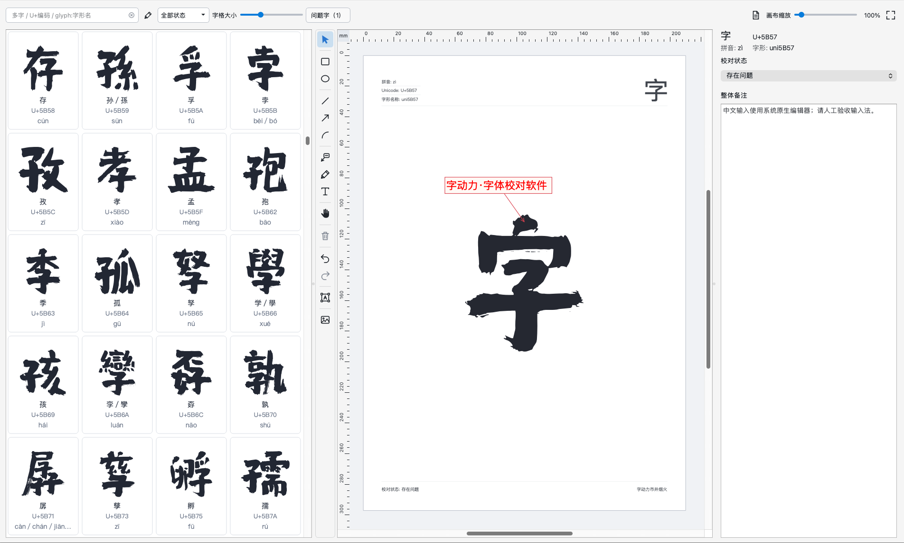
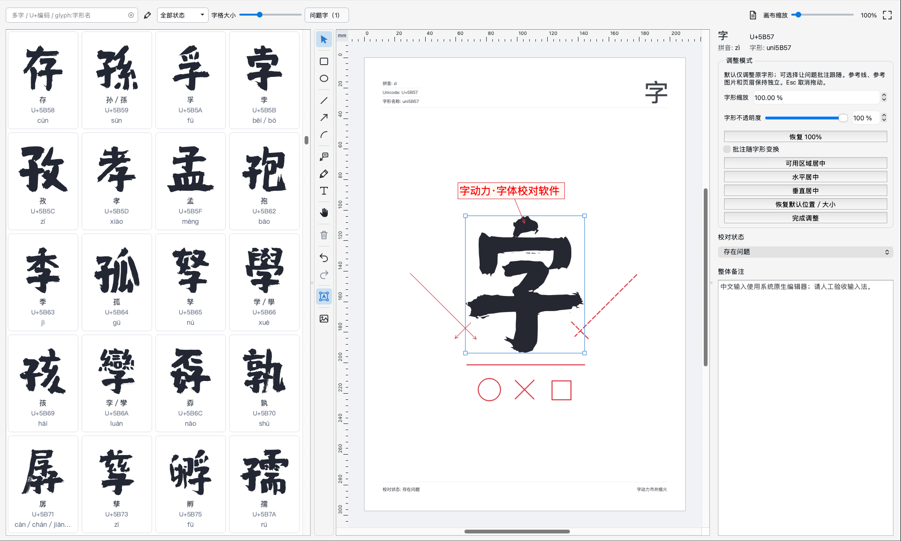

# 字动力·字体校对

**让每一个字，都经得起细看。**

专为字体设计师与字库校对工作打造的免费工具，支持 Windows 与 macOS。

## 软件下载

| 平台 | 正式版本 | GitHub 下载 | Gitee 下载 |
|---|---|---|---|
| Windows x64 | 0.3.155（170） | [EXE](https://github.com/dutao6678/zidongli-font-proof/releases/download/v0.3.155/ZidongliFontProof-Windows-x64.exe) | [EXE](https://gitee.com/postman7729/zidongli-font-proof/releases/download/v0.3.155/ZidongliFontProof-Windows-x64.exe) |
| macOS | 0.3.154（169） | [DMG](https://github.com/dutao6678/zidongli-font-proof/releases/download/v0.3.154/ZidongliFontProof-macOS-universal2.dmg) | [DMG](https://gitee.com/postman7729/zidongli-font-proof/releases/download/v0.3.154/ZidongliFontProof-macOS-universal2.dmg) |

## 软件界面展示

### 01 · 字库浏览与校对

浏览字格，在单字画布上标注问题，并记录校对状态。

### 02 · 批注与字形调整

选择并调整字形的位置与大小，配合辅助批注说明修改意见。

## 主要功能

### 字库浏览

支持 TTF、OTF、Glyphs 字体文件，提供字符搜索、拼音、Unicode 和简繁参考。

### 标注与调整

支持文字、箭头、矩形、椭圆、直线、弧线、自由画笔和图片批注，以及字形位置、大小调整。

### 问题字管理

记录校对状态与修改意见，集中查看问题字，支持保存和继续校对。

### 导出与交接

独立 `.zproof` 工程，支持 PDF、PNG、TXT 导出和打印预览。源字体始终只读。

## 使用说明与兼容提醒

- [使用说明](USAGE.md) · [Windows 正式 Release](https://github.com/dutao6678/zidongli-font-proof/releases/tag/v0.3.155) · [macOS 正式 Release](https://github.com/dutao6678/zidongli-font-proof/releases/tag/v0.3.154)
- Windows 为独立 EXE，无需安装 Python 或 Qt；Windows 10 1809 x64 为依赖要求下限。当前 EXE 未完成 Authenticode 代码签名。
- macOS 最低要求 15.0。使用 DMG 时，将应用拖入“应用程序”，推出 DMG 后启动；也可下载 ZIP：[GitHub ZIP](https://github.com/dutao6678/zidongli-font-proof/releases/download/v0.3.154/ZidongliFontProof-macOS-universal2.zip) · [Gitee ZIP](https://gitee.com/postman7729/zidongli-font-proof/releases/download/v0.3.154/ZidongliFontProof-macOS-universal2.zip)。当前版本未完成 Developer ID 签名及 Apple 公证。
- `.zproof` 工程默认不嵌入源字体，交接时需保留对应字体。新版工程中的新增数据可能无法由旧版读取，升级或回退前建议备份。
- 参考信息受数据覆盖范围影响；部分 `.glyphs` 特殊结构暂不支持，智能部件尚未正式支持。具体兼容范围以对应正式 Release 为准；Intel Mac、最低系统实机及实体打印仍待分别验收。
- 检查更新仅在用户主动操作时联网，不自动安装或替换应用。请下载 EXE、DMG 或应用 ZIP，不要把仓库自动生成的源码压缩包当作安装包。

## 联系与反馈

邮箱：[outlook5588@gmail.com](mailto:outlook5588@gmail.com) · [GitHub Issues](https://github.com/dutao6678/zidongli-font-proof/issues) · [Gitee Issues](https://gitee.com/postman7729/zidongli-font-proof/issues)

反馈请提供应用版本与构建号、系统版本、显示缩放、复现步骤及预期／实际结果；性能问题请注明涉及字格滚动、抓手、对象移动还是控制点缩放。

请先备份重要工程。公开反馈请勿上传私人字体、完整用户工程、个人资料、密钥或运行目录；优先使用可公开的测试样本和截图，私有材料由权利人决定是否提供。

## 使用条款和第三方许可

软件免费使用，应用源码不公开；使用及分发规则请参阅[使用条款](TERMS.md)。第三方组件保留原有许可。

[第三方许可说明](THIRD_PARTY.md) · [许可资料](LICENSES.txt) · [原生组件许可](NATIVE_LICENSES.txt)
