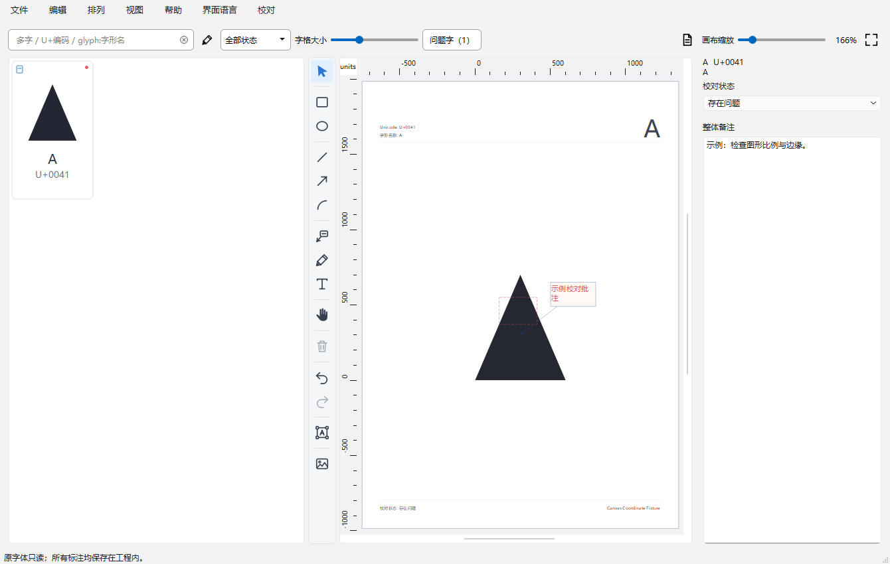

# 字动力·字体校对

用于字体设计与人工校对的免费桌面应用。打开字体、定位字形、记录问题、添加批注，并将校对页导出或打印；原始字体保持只读。

**Windows 版先行发布，macOS 版准备中。** macOS 后续仍在本产品仓库发行。本仓库只公开发行资料与第三方许可，不公开应用源码。

## 当前状态

首次公开发行正在准备，尚未公开正式 EXE 或正式更新清单。请勿将仓库自动生成的“Source code ZIP”当作应用安装包；该 ZIP 仅包含本仓库的公开资料。

## 官方渠道

- [GitHub 官方主页](https://github.com/dutao6678/zidongli-font-proof)
- [Gitee 官方主页](https://gitee.com/postman7729/zidongli-font-proof)
- 作者／品牌：**字动力**
- 联系／反馈：**outlook5588@gmail.com**，也可在任一仓库提交 Issue。

## 主要操作

1. 打开你有权使用的字体，在字格中搜索和选择字形。
2. 在右侧画布添加文字、箭头、矩形、椭圆或图片批注；支持撤销／重做及多选校对状态。
3. 保存为 `.zproof` 工程，再次打开继续校对；工程不修改原字体。
4. 按页面设置导出 PNG、PDF 或打开打印预览。

详细说明见 [使用说明](USAGE.md)、[反馈方式](FEEDBACK.md)、[首发说明](RELEASE_NOTES.md)、[使用条款](TERMS.md) 和 [第三方许可说明](THIRD_PARTY.md)。

## Windows 支持范围

计划提供 x64 单文件 EXE，非安装器，内置运行环境，运行时可解压至系统临时目录。已在 Windows 11 26100 验证指定功能；Windows 10 1809 x64 为依赖下限，尚未在最低系统或无开发环境干净机器完整实测。尚无 Windows ARM64 原生包。程序暂未进行 Authenticode 代码签名；清单签名和代码签名是不同事项。实体打印仍待设备验收。

## 更新方式

从“帮助 → 检查更新”主动发起。正式发行后由两个渠道提供签名版本清单，浏览器下载完整应用；保存工程并退出后再替换旧 EXE。本期不自动安装、不强制更新、不在启动时反复弹窗。macOS 未发行时不会推荐 Windows 文件。

## 资料许可

应用免费使用，源码私有，不套用 MIT／Apache 等作为本应用的开源授权。第三方组件及其资料按各自原有许可提供。

## 界面示例

截图使用自绘几何测试字形，不含用户工程或私人字体文件。
